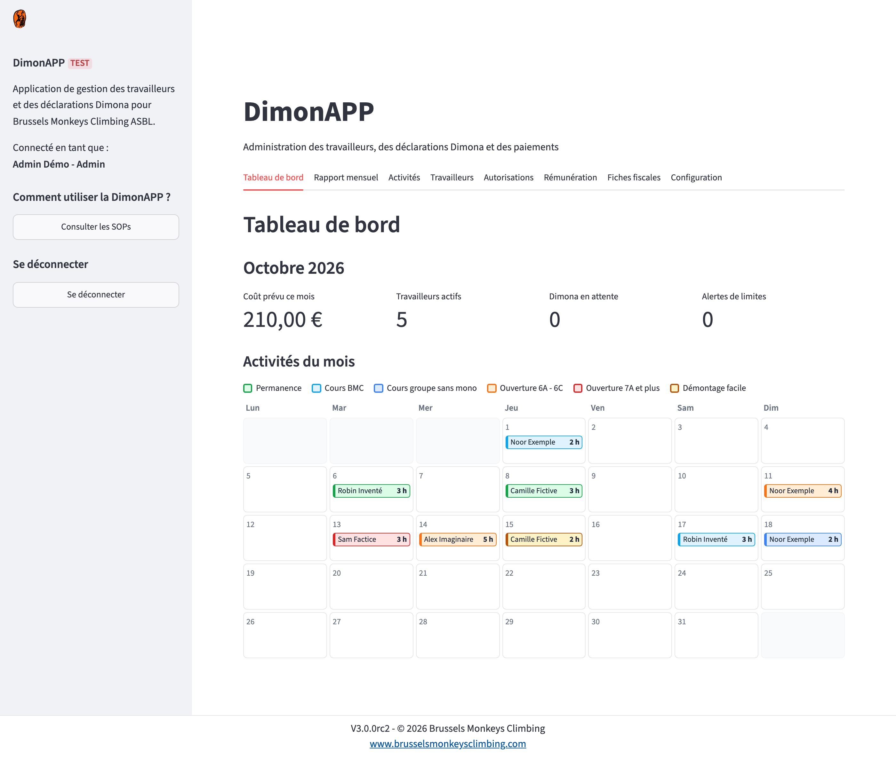
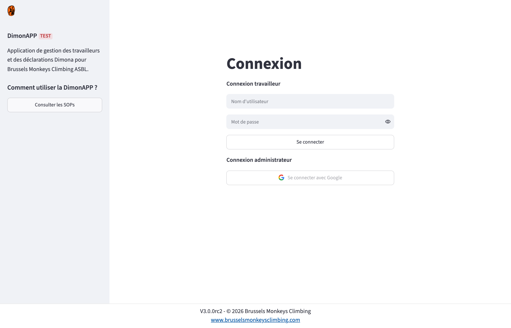
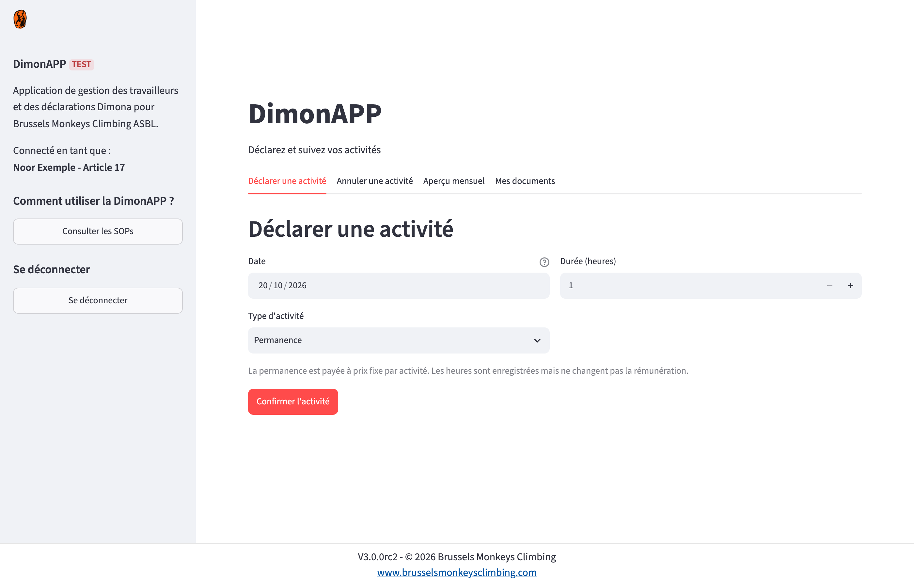
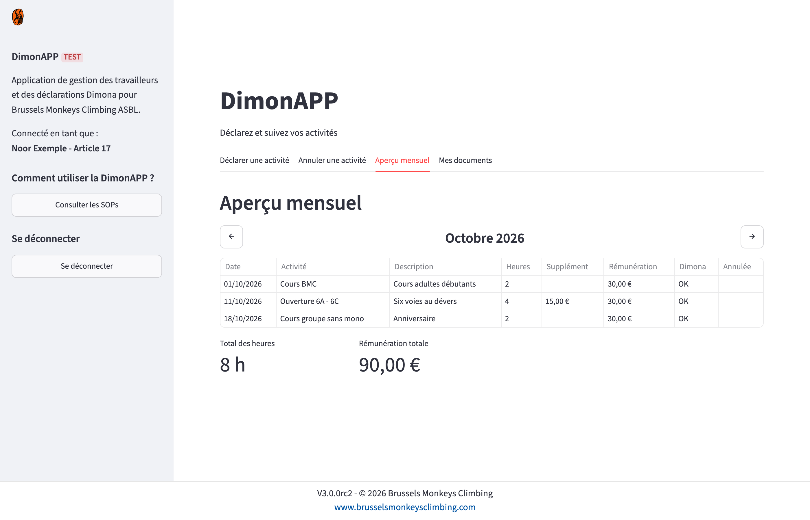
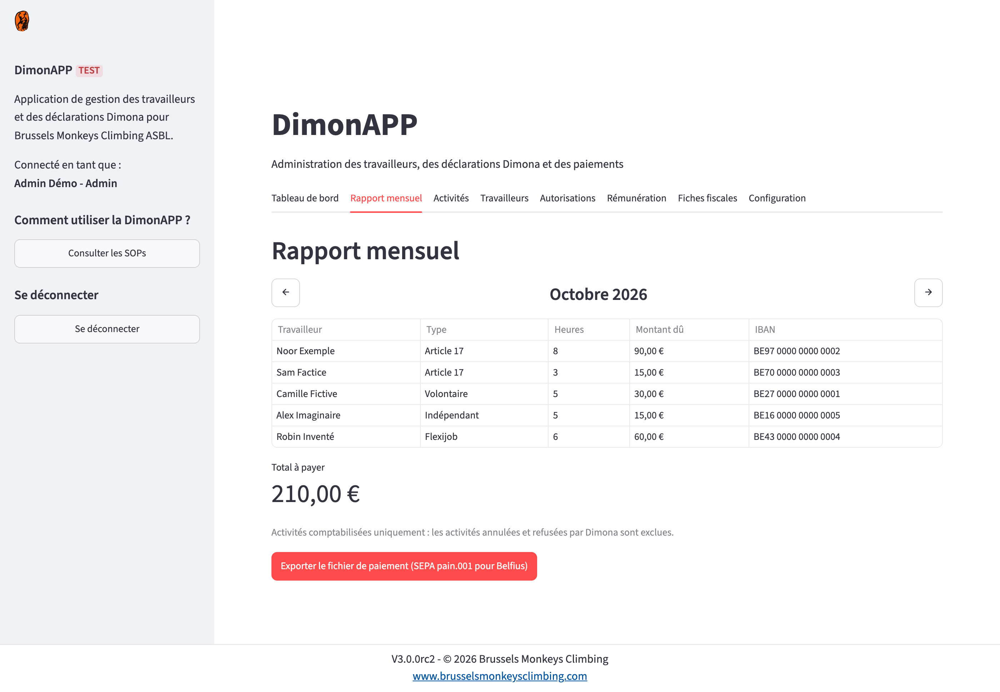
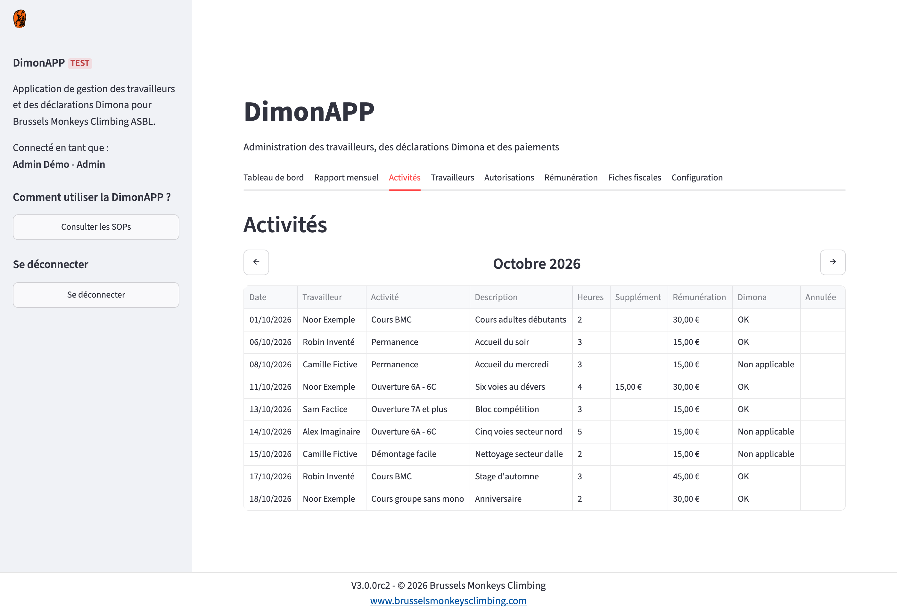
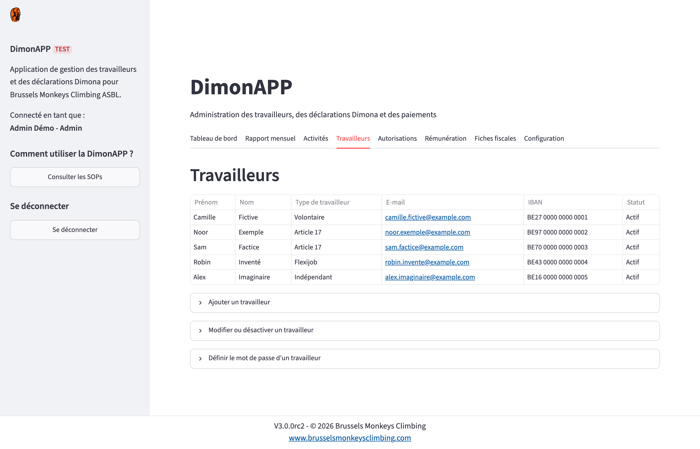

> This is a curated view of the real production app: its history is removed and names, infrastructure identifiers and the live address are left out. It is shared for viewing only; see `LICENSE`.

# DimonAPP V3.0

Worker administration and Dimona declarations for Brussels Monkeys Climbing ASBL.



| Login | Declaring an activity (worker) |
|---|---|
|  |  |
| **Monthly overview (worker)** | **Monthly report and payment export (admin)** |
|  |  |
| **Activities (admin)** | **Workers (admin)** |
|  |  |

The screenshots use fictional demo data in the `TEST` environment; `tools/screenshots/take-screenshots.sh` regenerates them (uv and Docker needed).

The application is built phase by phase from the specification in `docs/`.

| Path | What it is |
|---|---|
| `CLAUDE.md` | Instructions Claude Code reads automatically: stack, commands, rules |
| `docs/FDS.md` | Functional Design Specification (source of truth) |
| `docs/TRACEABILITY.md` | Requirement to code and test mapping, filled in during the build |
| `docs/DEPLOYMENT.md` | The exact commands to set up and update acceptance and production in GCP |
| `src/dimonapp/assets/` | The two logos: `favicon.png` and `logoarriere.png`, plus the resized copies of the favicon (`apple-touch-icon.png`, `tab-icon.png`) |
| `docs/openapi_dimona_v2.yaml` | Official RSZ specification of the Dimona REST service |
| `.env.example` | Template for the local, git-ignored `.env` |
| `docs/screenshots/`, `tools/screenshots/` | README screenshots and the script that regenerates them with fake data |

## Getting started

1. Install uv and Docker.
2. Copy `.env.example` to `.env` (never commit `.env`).
3. `make db` starts the local PostgreSQL, `make migrate` applies the database migrations.
4. `make seed` fills the local database with fake data. Set `SEED_PASSWORD` in `.env` first to sign in as a fake local worker (`camille`, `noor`, `robin`, `alex`), and `SEED_ADMIN_EMAIL` to sign in as admin with your own Google account.
5. `make run` starts the app, `make test` runs the tests (Docker must be running), `make lint` runs Ruff.

`APP_ENV` names the environment and decides the Dimona service:

| `APP_ENV` | Dimona |
|---|---|
| `TEST` | No Dimona call: a fake service answers. Set `FAKE_DIMONA_OUTCOME` to `accept` (default), `reject` or `timeout` and restart to see each message. Use this locally. |
| `ACC` | Real calls to the RSZ test service. Needs the `DIMONA_*` values and the private key (see `.env.example`); the key stays in a folder outside the repository. |
| `PROD` | Real calls to the live RSZ service. Never set this locally. |

`make test-rsz` optionally declares and cancels one activity at the RSZ test service, as `ACC`; it lives in `tests/integration/` and is never part of `make test`.

Uploaded contracts and qualifications are stored in the folder named by `STORAGE_FOLDER` (default `local_storage`, git-ignored); in GCP they go to the Cloud Storage bucket named by `STORAGE_BUCKET`.

Google sign-in needs the four Google variables of `.env.example`; without them the Google button is disabled and only the username and password form works.

## Deployment to GCP

Three environments run the same code; two of them live in GCP, in one project (`<project-id>` below), region `europe-west1`.

| Environment | Runs | Dimona | Data |
|---|---|---|---|
| `TEST` | Locally (`make run`), never in GCP | Fake service, no call | Fake (`make seed`) |
| `ACC` | Cloud Run service `dimonapp-acc` | RSZ test service | Fictitious workers the RSZ test service knows |
| `PROD` | Cloud Run service `dimonapp-prod` (not set up yet) | Live RSZ service | The real data |

- **One image.** Cloud Build builds the `Dockerfile` from `main` and tags it with the version of `src/dimonapp/__init__.py`. The same image goes to acceptance first and to production after acceptance passed.
- **Per environment, nothing shared.** Each has its own Cloud Run service (at most one instance, public HTTPS, the application handles the sign-in), Cloud SQL PostgreSQL instance (nightly backups; production adds point-in-time recovery and deletion protection), private bucket `dimonapp-<env>-documents`, service account `dimonapp-<env>` and Google OAuth client. Nothing is copied from one environment to the other.
- **Configuration.** Plain values (environment name, bucket, redirect address, Google client ID, RSZ identifiers, first admin) are set on the service at deploy time. Secrets (database URL, sign-in secrets, RSZ private key and its passphrase) come from Secret Manager as `dimonapp-<env>-...`, readable only by the service account of that environment.
- **Database.** The container applies the Alembic migrations when it starts, so a release migrates acceptance before it reaches production. The first admin comes from `FIRST_ADMIN_EMAIL`.
- **Releasing.** Build the image of the new version, update acceptance, test there, then update production with the same image (see below).

The sidebar names the environment, and the Dimona service follows from it alone: none in test, the RSZ test service in acceptance, the live RSZ service in production. The start-up log names the service in use.

The commands to set up an environment, the checks after a first deployment and the day-to-day tasks are in `docs/DEPLOYMENT.md`.

### Releasing a new version

Once the pull request of the version is merged, from the root of the repository. Sign in first with `gcloud auth login` when the last sign-in is some hours old.

1. Take the merged code and name the image after its version:

   ```bash
   git switch main && git pull
   export VERSION=$(uv run python -c "import dimonapp; print(dimonapp.__version__)")
   export IMAGE="europe-west1-docker.pkg.dev/<project-id>/dimonapp/dimonapp:$VERSION"
   ```

2. Build the image, once per version (about three minutes):

   ```bash
   gcloud builds submit --tag "$IMAGE" --project=<project-id>
   ```

3. Update acceptance. Only the image changes; settings, secrets and data stay, and the migrations run when the new container starts:

   ```bash
   export ENV=acc
   gcloud run services update "dimonapp-$ENV" --project=<project-id> --region=europe-west1 --image="$IMAGE"
   ```

4. Check it: the first command prints the image that runs, the second the start-up log (migrations applied, Streamlit started, no error). Then open the application and read the version in the footer.

   ```bash
   gcloud run services describe "dimonapp-$ENV" --project=<project-id> --region=europe-west1 --format='value(spec.template.spec.containers[0].image)'
   gcloud run services logs read "dimonapp-$ENV" --project=<project-id> --region=europe-west1 --limit=30
   ```

5. Test in acceptance. When it passes, repeat steps 3 and 4 with `export ENV=prod`: the same image, no new build.

To go back, run step 3 with the tag of the previous version. That does not undo a migration, so check the pull requests in between first.

### Adding an admin

The application has no screen to manage admins: an admin is a row in the `admins` table of the environment, holding the Google address the person signs in with. `FIRST_ADMIN_EMAIL` creates the first one only, while the table is still empty.

In acceptance or production:

1. In the Google Cloud console open Cloud SQL, the instance `dimonapp-<env>` (`dimonapp-acc` or `dimonapp-prod`), then "Cloud SQL Studio".
2. Sign in to the database `dimonapp` as user `dimonapp`. The password is part of the database URL kept in Secret Manager, between `dimonapp:` and `@`:

   ```bash
   gcloud secrets versions access latest --secret=dimonapp-<env>-database-url --project=<project-id>
   ```

3. Add the address, in lower case:

   ```sql
   INSERT INTO admins (email) VALUES ('name@example.com');
   ```

The new admin signs in with the Google button straight away; nothing needs to be deployed. Locally the same statement goes through the database container:

```bash
docker compose exec db psql -U dimonapp -d dimonapp -c "INSERT INTO admins (email) VALUES ('name@example.com');"
```

- An address that is in both tables, admins and workers, signs in as admin.
- To take the access away, deactivate the row instead of deleting it: `UPDATE admins SET is_active = false WHERE email = 'name@example.com';`. A deactivated admin is refused at sign-in.

## Way of working

Each phase, feature or requirement is built on its own branch and reviewed before it reaches `main`:

1. Claude Code creates a branch named `claude/<phase>` or `claude/<feature>`.
2. It implements the work following the Python style in `CLAUDE.md`.
3. It raises the version in `src/dimonapp/__init__.py`, once per pull request.
4. It runs Ruff (line length 100) and the full test suite; both must be clean.
5. It opens a pull request listing the version and the requirement IDs covered.
6. It stops and asks for review. Only the maintainer merges; nothing is pushed directly to `main`.
