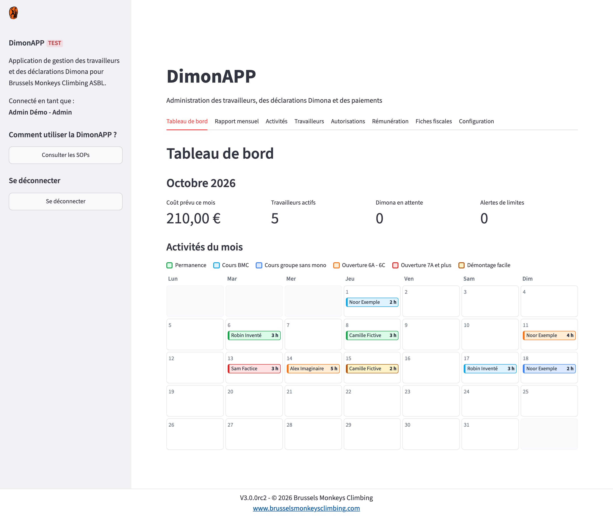
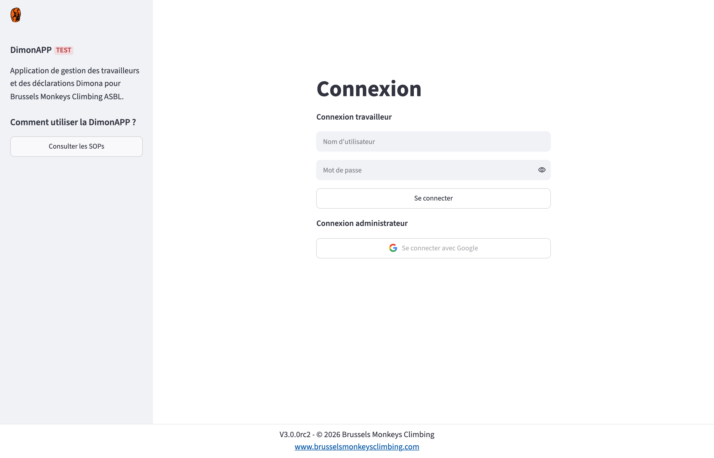
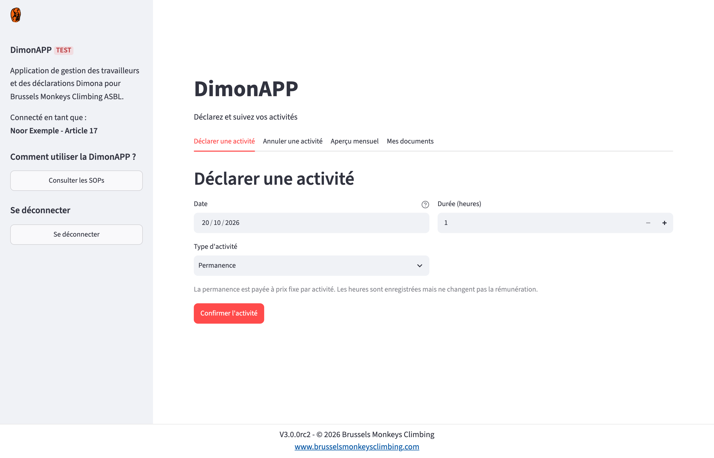
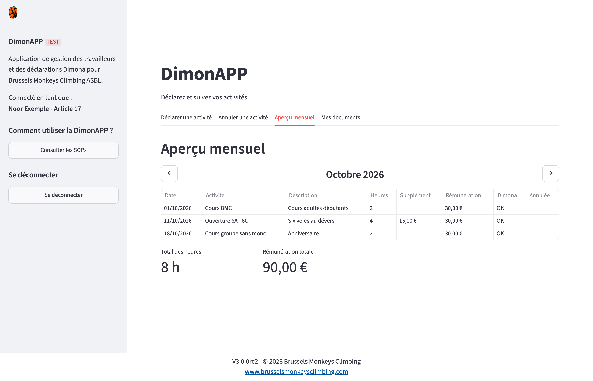
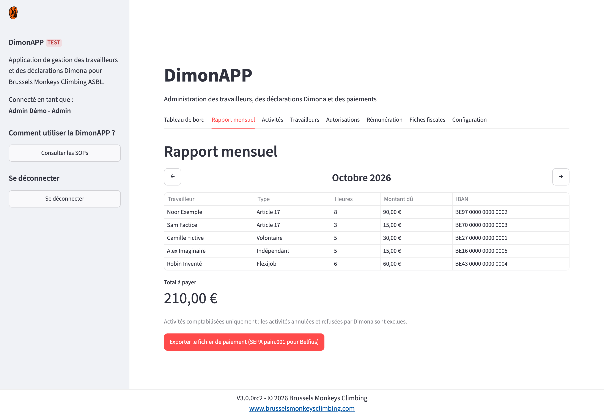
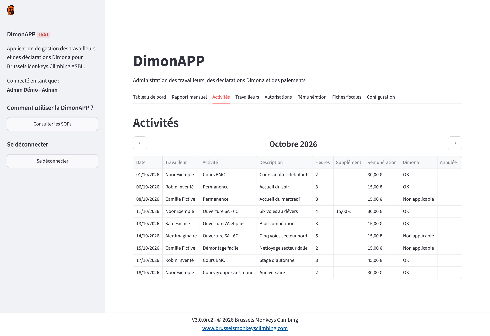
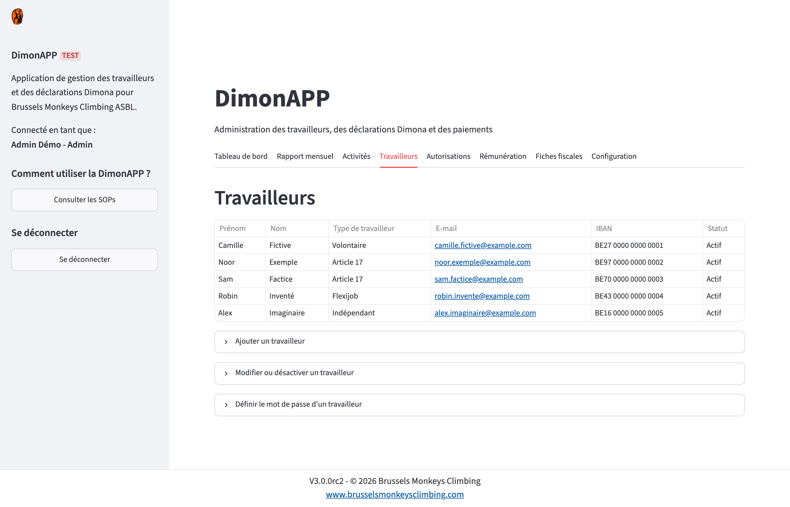
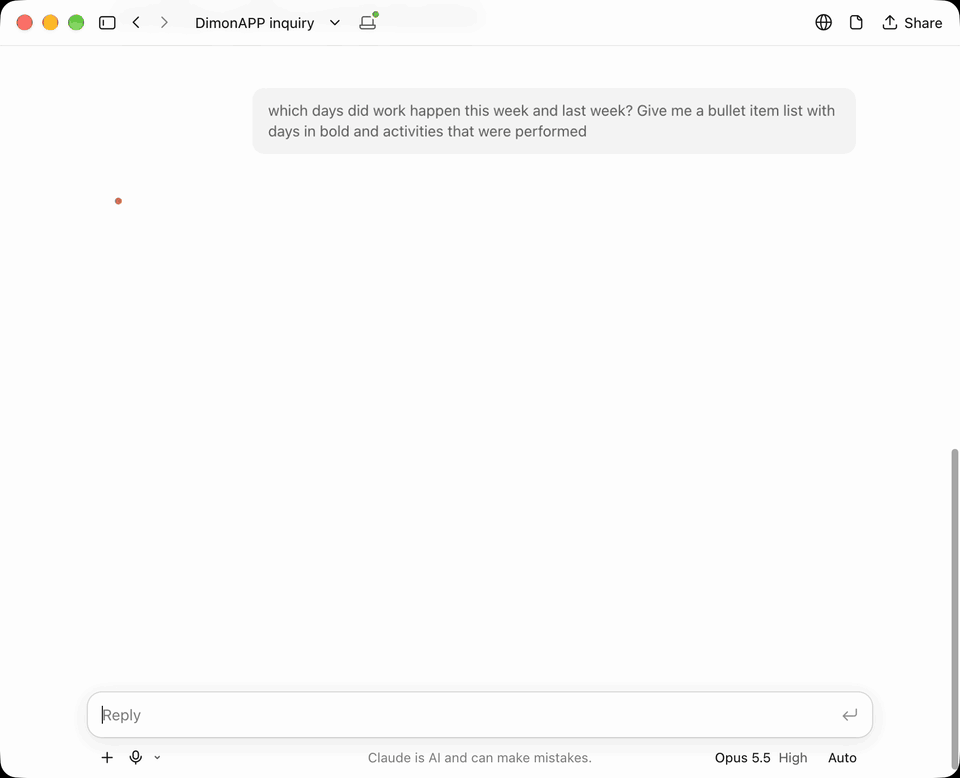

> This is a curated view of the real production app: its history is removed and names, infrastructure identifiers and the live address are left out. It is shared for viewing only; see `LICENSE`.

# DimonAPP

DimonAPP is the web application Brussels Monkeys Climbing ASBL (BMC), a climbing association in Brussels, uses to run the people who work at its gym. Workers declare what they will do: open the gym, give a course, set or clean a route. The application checks that they are allowed to do it, declares them to Belgian social security when the law requires it, and turns everything into the monthly payments and the yearly tax fiches. Admins can also ask Claude questions about the activities without any personal data reaching the model.

It replaces BMC's timesheet and succeeds an earlier in-house tool, and runs in production as version 3.1.0. The interface is in French.



## The problem it solves

A Belgian association that pays people for occasional work has to get a few things right, every time:

- **Declare before work starts.** Article 17 workers ("verenigingswerk") and flexi-jobbers must be declared to the RSZ/ONSS through a *Dimona* declaration before they start.
- **Only let qualified people work.** Nobody may set routes or give a course without a valid contract and proof of training on file.
- **Stay within the legal limits.** Each worker type has yearly and quarterly caps on hours and earnings, indexed every year.
- **Pay correctly and report it.** Every month, everyone gets paid by bank transfer. Every year, each article 17 worker gets a fiscal fiche 281.27, and the association files them electronically with the tax administration (Belcotax-on-web).

DimonAPP turns these into one flow: a worker declares an activity once, and the checks, the declaration, the pay and the fiche all follow from that.

## How it works

### For a worker

A worker signs in with Google or with a username and password an admin gave them, and has four tabs:

- **Declare an activity.** Pick the date, the activity type and the duration. When the worker submits, the application checks, in order:
  1. that the input is valid (not in the past, at most three months ahead, flexi-job minimum of 3 hours);
  2. that a valid contract for the worker's type covers this activity on this date;
  3. that a valid qualification covers it too;
  4. then it computes the pay from the worker's rates and, for an article 17 worker or a flexi-jobber, sends the Dimona declaration to the RSZ right away and waits for the answer.

  The worker sees the real outcome: accepted, rejected with the RSZ's reason, or *pending* when the RSZ gives no answer within two minutes.
- **Cancel an activity.** For an activity with a Dimona, the application cancels the declaration at the RSZ first, and marks the activity cancelled only once the RSZ confirms.
- **Monthly overview.** The month's activities, their pay and their Dimona status, with the month's totals.
- **My authorisations.** The worker's contracts and qualifications, and whether each one is still valid.

### For an admin

Admins sign in with Google only and see the whole association:

- **Dashboard.** The projected cost of the month, workers close to a legal limit, declarations still pending at the RSZ (which the admin resolves after checking the RSZ portal), contracts that are about to expire, and a calendar of the month's accepted activities.
- **Workers.** Create, edit and deactivate workers. National register numbers and IBANs are validated with their checksums on entry, so typos never reach the RSZ or the bank.
- **Authorisations.** Upload contracts and qualifications and say which activities they cover. A document that an activity relied on cannot be deleted: it is the proof that the person was allowed to do the work.
- **Compensation.** One rate sheet per worker. Each rate has a start date, so a raise never changes the pay of work already declared.
- **Monthly report.** What each worker is owed, and one click for the SEPA payment file the bank imports.
- **Fiches 281.27.** At year end, one click produces every article 17 worker's fiche as a PDF, plus the Belcotax XML file for the tax administration.
- **Activities and configuration.** Every activity of a month, the yearly legal limits, and BMC's own details.

| Login | Declaring an activity (worker) |
|---|---|
|  |  |
| **Monthly overview (worker)** | **Monthly report and payment export (admin)** |
|  |  |
| **Activities (admin)** | **Workers (admin)** |
|  |  |

The screenshots use fictional demo data; `tools/screenshots/take-screenshots.sh` regenerates them.

### Four kinds of worker

| Worker type | Dimona | Legal limits | Year end |
|---|---|---|---|
| Volunteer | Not required | Yearly compensation cap | Nothing |
| Article 17 | Required | Hours per quarter and per year, yearly compensation cap | Fiche 281.27 (PDF and Belcotax XML) |
| Flexi-jobber | Required, with start and end time | Minimum 3 hours per activity, yearly earnings cap | Not in scope |
| Freelancer | Not required | None | Nothing (invoices BMC) |

A worker can only move up from volunteer to article 17 to flexi-job, never down, and each status starts with fresh limits.

### Rules it never breaks

- **The outcome is never assumed.** What a worker sees and what is stored is always the RSZ's real answer, or "pending" when there is none.
- **A declaration is permanent.** A declared activity keeps the rate, worker type and amount it was declared with. Only its cancellation, or an admin resolving a pending Dimona, can change it later.
- **Limits warn, they do not block.** Planned activities count too, so the dashboard flags a problem before it happens. Deciding what to do stays with the admin.
- **Personal data stays where it belongs.** National register numbers and IBANs live in one table and never appear in logs. Passwords exist only as hashes.

## Asking Claude: the MCP server

An admin can ask an AI assistant such as Claude about the declared activities: how many hours were declared this week, whether every weekday had a declaration, which activities need a look, whether the current month looks correct. The answers come from a separate, read-only server that Claude connects to through MCP (the Model Context Protocol, the open standard through which an AI assistant calls the tools of a server). The board of BMC approved it for production on one condition: no personal data may reach the model.

Below, Claude is connected to the acceptance environment, on fictitious data. The admin asks which days had work in the last two weeks, then for the anomalies of the month. Only dates, hours, activity types, worker types and Dimona statuses come back (sped up twice).



| Tool | Answers |
|---|---|
| `summarise_period(start, end)` | Counted hours and activities per activity type and worker type, distinct workers, cancelled, rejected and pending declarations |
| `list_daily_activities(start, end)` | Every day of the period, with its activities, empty days included |
| `find_anomalies(start, end)` | Pending or rejected Dimona, cancellations, long activities and days, many days in one week, flexi-jobs under the minimum, missing limits, workers near a legal limit |
| `review_month(year, month)` | The summary, the empty days and the anomalies of one month |

There is also a resource with the catalogue of activity types and a prompt for the monthly review, which asks the model to answer in French.

### Privacy

**No personal data, no direct identifiers, and no pay or banking data leaves the database or is exposed to the model.** The tools return hours, counts, dates, activity types, worker types, Dimona statuses and activity ids. They never return a name, an e-mail address, a national register number, an IBAN, a postal address or a worker id, never an amount in euro and never free text. Anything that needs a follow-up comes back as an activity id and a date, which the admin opens in the application.

**The limit of the guarantee.** Aggregates are not anonymous in an organisation this small: "the only flexi-jobber worked on Tuesday" points to one person. The guarantee is about identifiers and sensitive attributes, not anonymity. For the same reason, no tool answers a question about one person.

The rule is enforced in four layers, so a mistake in one of them does not leak:

1. **Database.** The server signs in as a role of its own that can read only a few purpose-built views: no table, no euro column, no free text. Limits in euro are compared inside the database, which returns only how many workers are near a limit.
2. **Code.** Only fixed tools, whose typed outputs have no field for any of the data above. There is no free-form query and no way to write.
3. **Infrastructure.** The server runs as a service account of its own, which cannot reach the application's secrets, the documents, the Dimona key or the other environment's database.
4. **Tests.** A leak test calls every tool, resource and prompt on seeded data and looks for every name, identifier, address and amount. A privilege test checks that the role is refused on every table, and sign-in tests check that only an active admin gets in.

### Access

- `/public/mcp` needs no sign-in and only says what the server is.
- `/mcp` needs Google sign-in and lets in only an active admin of the application. Every other account is refused, including a worker's Google account. Sign-ins are sent back only to known MCP clients: Claude, or an address on the admin's own machine.
- In acceptance and production the server refuses to start without sign-in. Locally it may run without sign-in, on fake data, and only listens on the developer's own machine.

To connect from Claude: Settings, Connectors, Add custom connector, with the address of `/mcp` (`docs/DEPLOYMENT.md`, section 7).

## How it was built

The project started from a written specification and was built against it in small, reviewed steps:

- **Specification first.** `docs/FDS.md` describes every screen, rule and flow, with about 170 numbered requirements and a history of every change. If a requirement changes, the specification is updated first, then the code.
- **Traced to the end.** `docs/TRACEABILITY.md` maps each requirement to the code that implements it and to the test or manual check that proves it.
- **Built with Claude Code, owned by a person.** `CLAUDE.md` sets the rules Claude Code works by: style, security, one branch and one reviewed pull request per piece of work, and lint and tests clean before a PR is opened. The specification, the decisions and the review of every pull request stay with the maintainer.
- **Tested where it matters.** About 850 tests. The business rules are plain functions, tested without the UI. The database tests run against a real PostgreSQL, and the RSZ is always faked in tests.
- **Three environments, one build.** A local test environment with a fake RSZ, an acceptance environment on the RSZ test service, and production, all from the same image.

Under the hood: Python, Streamlit, SQLAlchemy and PostgreSQL, the [fastmcp](https://gofastmcp.com) package for the MCP server, and Google Cloud (Cloud Run, Cloud SQL, Cloud Storage, Secret Manager) in `europe-west1`.

## Repository layout

| Path | What it is |
|---|---|
| `docs/FDS.md` | Functional Design Specification, the source of truth |
| `docs/TRACEABILITY.md` | Every requirement mapped to its code and tests |
| `docs/DEPLOYMENT.md` | The exact commands to set up and update acceptance and production in GCP |
| `docs/openapi_dimona_v2.yaml` | Official RSZ specification of the Dimona REST service |
| `src/dimonapp/` | The application, the MCP server and the database migrations |
| `tests/` | The test suite; `tests/integration/` holds the optional call to the RSZ test service |
| `docs/media/` | The recording of the MCP server above |
| `docs/screenshots/`, `tools/screenshots/` | README screenshots and the script that regenerates them with fake data |
| `src/dimonapp/assets/` | The two logos, `favicon.png` and `logoarriere.png`, and the resized copies of the favicon |
| `CLAUDE.md` | Instructions Claude Code reads automatically: stack, commands, rules |
| `.env.example` | Template for the local, git-ignored `.env` |

## Running it locally

1. Install uv and Docker.
2. Copy `.env.example` to `.env` (never commit `.env`).
3. `make db` starts the local PostgreSQL, `make migrate` applies the database migrations.
4. `make seed` fills the local database with fake data. Set `SEED_PASSWORD` in `.env` first to sign in as a fake local worker (`camille`, `noor`, `robin`, `alex`), and `SEED_ADMIN_EMAIL` to sign in as admin with your own Google account.
5. `make run` starts the app, `make test` runs the tests (Docker must be running), `make lint` runs Ruff.

`APP_ENV` names the environment. It decides only which Dimona service is used, the label in the sidebar, and whether the MCP server may run without sign-in:

| `APP_ENV` | Runs | Dimona | Data |
|---|---|---|---|
| `TEST` | Locally, never in GCP | No call: a fake service answers. `FAKE_DIMONA_OUTCOME` is `accept` (default), `reject` or `timeout` | Fake (`make seed`) |
| `ACC` | Cloud Run services `dimonapp-acc` and `dimonapp-mcp-acc` | The RSZ test service. Needs the `DIMONA_*` values and the private key (see `.env.example`), kept in a folder outside the repository | Fictitious workers the RSZ test service knows |
| `PROD` | Cloud Run services `dimonapp-prod` and `dimonapp-mcp-prod`. Never set locally | The live RSZ service | The real data |

Good to know:

- **Google sign-in** needs the four Google variables of `.env.example`. Without them the Google button is disabled, and only the username and password form works.
- **Uploaded documents** go to the folder named by `STORAGE_FOLDER` (default `local_storage`, git-ignored); in GCP, they go to the Cloud Storage bucket named by `STORAGE_BUCKET`.
- **The RSZ test service:** `make test-rsz` declares and cancels one activity there, as `ACC`. It lives in `tests/integration/` and is never part of `make test`.
- **The MCP server:** after `make migrate`, `make mcp-user` creates its database user. With the `MCP_DATABASE_URL` of `.env.example`, `make mcp` serves `http://127.0.0.1:8081/mcp` without sign-in, on the fake local data only. Add it to Claude Code with `claude mcp add --transport http dimonapp http://127.0.0.1:8081/mcp`.

## Operations

Acceptance and production live in one GCP project (`<project-id>` below), region `europe-west1`, each with its own services, database, bucket, service accounts and secrets; nothing is shared or copied between them. The container applies the database migrations when it starts, so a release migrates acceptance before it reaches production. `docs/DEPLOYMENT.md` has the commands to set up an environment, the checks after a first deployment, and the day-to-day tasks.

### Releasing a new version

Once the pull request of the version is merged, run these from the root of the repository. Sign in first with `gcloud auth login` if your last sign-in was a few hours ago.

1. Take the merged code and name the image after its version:

   ```bash
   git switch main && git pull
   export VERSION=$(uv run python -c "import dimonapp; print(dimonapp.__version__)")
   export IMAGE="europe-west1-docker.pkg.dev/<project-id>/dimonapp/dimonapp:$VERSION"
   ```

2. Build the image, once per version (about three minutes):

   ```bash
   gcloud builds submit --tag "$IMAGE" --project=<project-id>
   ```

3. Update acceptance, then its MCP service, with the same image. Only the image changes; settings, secrets and data stay as they are:

   ```bash
   export ENV=acc
   gcloud run services update "dimonapp-$ENV" --project=<project-id> --region=europe-west1 --image="$IMAGE"
   gcloud run services update "dimonapp-mcp-$ENV" --project=<project-id> --region=europe-west1 --image="$IMAGE"
   ```

4. Check it. The first command prints the image that runs, the second the start-up log (migrations applied, Streamlit started, no error). Then open the application and read the version in the footer.

   ```bash
   gcloud run services describe "dimonapp-$ENV" --project=<project-id> --region=europe-west1 --format='value(spec.template.spec.containers[0].image)'
   gcloud run services logs read "dimonapp-$ENV" --project=<project-id> --region=europe-west1 --limit=30
   ```

5. Test in acceptance. When it passes, repeat steps 3 and 4 with `export ENV=prod`: the same image, no new build.

To go back, run step 3 with the tag of the previous version. That does not undo a migration, so check the pull requests in between first.

### Adding an admin

There is no screen to manage admins. An admin is a row in the `admins` table of the environment, holding the Google address the person signs in with. `FIRST_ADMIN_EMAIL` creates only the first one, while the table is still empty.

In acceptance or production:

1. In the Google Cloud console, open Cloud SQL, then the instance `dimonapp-<env>` (`dimonapp-acc` or `dimonapp-prod`), then "Cloud SQL Studio".
2. Sign in to the database `dimonapp` as user `dimonapp`. The password is part of the database URL kept in Secret Manager, between `dimonapp:` and `@`:

   ```bash
   gcloud secrets versions access latest --secret=dimonapp-<env>-database-url --project=<project-id>
   ```

3. Add the address, in lower case:

   ```sql
   INSERT INTO admins (email) VALUES ('name@example.com');
   ```

The new admin can sign in with the Google button straight away; nothing needs to be deployed. Locally, run the same statement through the database container:

```bash
docker compose exec db psql -U dimonapp -d dimonapp -c "INSERT INTO admins (email) VALUES ('name@example.com');"
```

- An address that is in both tables, admins and workers, signs in as admin.
- To take access away, deactivate the row instead of deleting it: `UPDATE admins SET is_active = false WHERE email = 'name@example.com';`. A deactivated admin is refused at sign-in.
